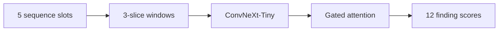

# Knee MRI Research Explorer

A model that predicts 12 knee MRI findings from RSNA competition scans, with a local app that runs the same model on CPU.

- **What I built:** a training and evaluation pipeline, weak-label analysis, and a local image viewer with model scores.
- **Result:** ConvNeXt-Tiny epoch 8 achieved **0.833 public / 0.824 private macro ROC AUC** in the competition.
- **Contributions:** I used published labels and ImageNet initialization. AI assisted the training implementation, evaluation, analysis, app, packaging and tools. [Full attribution](THIRD_PARTY.md).


The image shows an artificial DICOM phantom. Its scores have no medical meaning. [Captioned walkthrough](docs/demo.mp4).

## Problem and data

An MRI study has many slices and sequences; several abnormalities can coexist.
I used [Pilkwang Kim's weak labels](https://www.kaggle.com/datasets/pilkwang/rsna-knee-llm-labels): labels extracted automatically from radiology reports.
Training keeps known soft scores and masks unknown (`UNK`) findings instead of treating them as negatives.
The inherited split contains **3,655 fitting / 637 weak-validation / 58 expert-development studies**. I checked group separation; I did not design the original split. [Data and training details](training/README.md).

## How it works



Three adjacent slices form each 224×224 window. ConvNeXt encodes the windows; finding-specific attention combines the valid ones into study scores. This is **multiple-instance learning (MIL)**. Inference uses up to 40 windows and excludes unavailable windows with masks. Epoch selection uses complete weak-validation binary cross-entropy (BCE). [Source and settings](training/README.md).

## Results

**AUC measures how well scores rank positives above negatives**, not percentage accuracy. Weak-validation macro AUC is **0.848**. The table uses known binary report verdicts from the 637 validation studies; unknown labels are excluded.

| Finding | AUC | Positives | Negatives |
| --- | ---: | ---: | ---: |
| ACL | 0.831 | 181 | 405 |
| MCL | 0.767 | 121 | 463 |
| Medial meniscus | 0.838 | 370 | 235 |
| Lateral meniscus | 0.788 | 172 | 408 |
| Medial OA | 0.909 | 246 | 230 |
| Lateral OA | 0.871 | 174 | 256 |
| Patellofemoral OA | 0.894 | 304 | 221 |
| Effusion | 0.867 | 381 | 188 |
| Synovitis | 0.826 | 86 | 13 |
| Baker's cyst | 0.865 | 155 | 176 |
| Contusion | 0.821 | 188 | 319 |
| Fracture | 0.898 | 46 | 225 |

OA means osteoarthritis. The reused expert-development set scored **0.853**; it is not an independent test. [Exact metrics and reproduction](docs/PER_FINDING_EVALUATION.md).

## What I learned

- I found uneven supervision. Synovitis had only 13 known validation negatives. I cannot attribute its errors to the encoder alone.
- I kept epoch 8. The extra-epoch refinement worsened validation BCE from **0.537 to 0.567**, despite a small public-score increase.
- I checked the data before attempting a pooling comparison. Complete cache shards were missing from the audited assets, so I deferred it. [Experiment record](docs/TRAINING_HISTORY.md) · [Pooling status](docs/POOLING_FEASIBILITY.md).

## Limits

For students and researchers studying weak supervision and local model deployment. **Not for diagnosis or patient care.** Labels are noisy, scores are uncalibrated, and scanner/site generalization is unverified. The pooling experiment is unrun. Weights and medical data remain private. [Model card](docs/MODEL_CARD.md).

## Run locally

Python 3.12; first obtain an authorized [model bundle](models/README.md). A public clone has no weights.

```powershell
.\setup.ps1
& '.\.venv\Scripts\python.exe' 'scripts\import_bundle.py' 'C:\path\to\authorized-output.zip'
.\start.ps1
```

Open [localhost](http://127.0.0.1:7860/). [Setup, API, tests and Docker](docs/LOCAL_USAGE.md). No paid service is configured.

## Repo map and credits

[training/](training/README.md): original pipeline · [app/](app/): CPU application · [scripts/](scripts/): analysis/checks · [tests/](tests/): automated tests · [docs/](docs/): curves, errors, deployment evidence and limits.

[Engineering evidence](docs/ENGINEERING_EVIDENCE.md) · [Release review](docs/RELEASE_NOTES.md) · [Credits and licenses](THIRD_PARTY.md). Project-authored code/docs use MIT; data, model and dependency rights remain separate.
