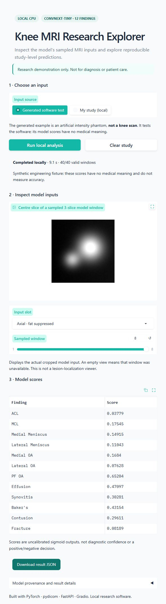

# Knee MRI Research Explorer

Local CPU research demo for a project-trained ConvNeXt-Tiny multiple-instance classifier. **Not for diagnosis or patient care.**

**Project result:** 0.833 public macro ROC AUC; five MRI input slots, 40 three-slice windows, 12 findings. One real-study Windows/Kaggle replay matched every processed pixel and mask, with a maximum score difference below 6e-8. This is deployment consistency evidence, not clinical validation.

https://github.com/user-attachments/assets/3e6ca849-924f-4360-852c-d34c7b04c6a2

Training used [Pilkwang Kim's public report-derived labels](https://www.kaggle.com/datasets/pilkwang/rsna-knee-llm-labels) and ImageNet initialization. [Full credits and data boundaries](THIRD_PARTY.md). Development used AI coding assistance.

[Watch the 60-second captioned demo](docs/demo.mp4) · [Captions/transcript](docs/demo.vtt). The demo uses actual browser captures of generated DICOMs, held for readability; it has no narration and is not a real-time latency recording.

<details>
<summary>View the generated-data screenshot</summary>



</details>

No payments, subscriptions, paid APIs, cloud GPU or hosted services are used. No Gradio public share link is created. The full competition dataset is not required.

## Start on Windows

Python 3.12 is required. From this folder:

```powershell
.\setup.ps1
```

If Python 3.12 is installed outside PATH and the usual Windows install folder, pass its executable explicitly: `.\setup.ps1 -PythonPath 'C:\path\to\python.exe'`.

If your PowerShell policy blocks scripts, run the existing environment directly without changing system policy:

```powershell
& '.\.venv\Scripts\python.exe' 'run.py'
```

**A public clone contains code and the generated demo, but no trained weights or MRI data.** To run inference, you must already have authorized access to the exact model bundle described in [models/README.md](models/README.md). Import that downloaded bundle before starting the app:

```powershell
& '.\.venv\Scripts\python.exe' 'scripts\import_bundle.py' 'C:\path\to\authorized-output.zip'
```

Import verifies source/checkpoint identities before writing private model assets. It never downloads weights or replaces application source. Without authorized weights, you can inspect the code, watch the demo and run the model-independent tests below; inference remains unavailable.

After importing authorized weights, run `.\start.ps1` and open http://127.0.0.1:7860/. API documentation: http://127.0.0.1:7860/docs. The readiness endpoint returns 503 while the model loads or if weights are missing.

Choose **Generated software test** and run analysis. This creates an artificial DICOM phantom, not a knee scan; its outputs have no medical meaning. No real example scans are redistributed.

## Analyze an authorized local study

Choose **My study (local)**. Provide one ZIP containing `StudyUID/SeriesUID/*.dcm` and a CSV with `StudyInstanceUID,SeriesInstanceUID,Anatomical_Plane,Fat_Suppression,Fluid_Sensitive`.
Plane values: Sagittal/Coronal/Axial. Flags: 0/1 or true/false. Both identifiers must match the archive. Unsupported/multiframe studies fail rather than receiving invented scores.

The viewer shows centre slices of sampled, cropped model windows. Results are 12 uncalibrated scores, validity/warning information, stage timings and checkpoint provenance. They are not calibrated risks or diagnostic decisions.

## API

`POST /api/v1/jobs` with multipart `kind=synthetic` returns an ID and access token. For uploads, use `kind=upload`, `study` and `metadata` files. Pass `Authorization: Bearer TOKEN` to job status, result, preview and delete endpoints. Poll status; retrieve the result only on completion. Keep tokens private.

## Data handling

One study at a time, three waiting jobs. Study ZIPs, extracted data, previews and results live under ignored `.runtime/jobs/`; expire 30 minutes after completion and are removed on error, clear or shutdown. Stale job directories are cleaned at next startup. The interface uses a separate `.runtime/gradio/` file cache with an approximately 30-minute expiry and shutdown cleanup. Avoid uploading patient data into portfolio demos; keep this app local.

Code, tests, synthetic generation and documentation can be versioned. `.gitignore` excludes model weights, studies, runtime files and credentials. No GitHub repository or remote hosting is created automatically.

## Tests

```powershell
& '.\.venv\Scripts\python.exe' -m pytest -q
```

When weights are absent, three model-dependent tests are explicitly skipped; other tests still run. Require the full trained-model checks with:

```powershell
& '.\.venv\Scripts\python.exe' -m pytest -q --require-model
```

This command fails if private weights are missing or invalid; it does not substitute a random model.

Verified on a fresh Windows Python 3.12 environment on 25 October 2026: **15 passed, 3 skipped** without weights, then **18 passed** after verified model import. `pip check` passed. The complete checks include actual model masking/request independence and worker timeout/recovery.

Real-study Windows replay passed on one privately held competition study: all processed pixels and masks matched Kaggle exactly; the maximum difference across 12 scores was 5.96e-8. This checks deployment consistency, not clinical accuracy. See [the verification record](docs/REAL_STUDY_VERIFICATION.md).

The same study also passed Linux container replay: exact input pixels/mask and all 12 scores within 1.20e-7 of Kaggle. Four API requests produced identical scores. Subsequent worker processing had a 6.127-second median; API-container cgroup peak memory was approximately 975 MiB under a two-CPU, 2 GiB limit. These are one-study observations on a shared local machine, not hosting requirements or a general latency guarantee. See [the Linux parity and performance record](docs/LINUX_REAL_STUDY_BENCHMARK.md).

To repeat with your own authorized private export, without downloading anything or using a GPU:

```powershell
& '.\.venv\Scripts\python.exe' 'scripts\verify_real_study.py' 'data\local_replay'
```

The app must already be running. The data folder is optional and excluded from Git and Docker. See [the portfolio/demo checklist](docs/PORTFOLIO.md) before publishing.

## Docker (optional, local CPU)

Built and tested on Windows/WSL2 with a Linux image on 25 October 2026. Import the authorized weights first and start Docker Desktop's Linux engine. From the project folder:

```powershell
docker --context desktop-linux build --builder desktop-linux -t knee-mri-explorer:local .
docker --context desktop-linux run --rm --init --name knee-mri-explorer --read-only --cpus 2 --memory 2g --pids-limit 256 --cap-drop ALL --security-opt no-new-privileges --tmpfs /tmp:rw,nosuid,noexec,size=128m --tmpfs /opt/knee/.runtime:rw,nosuid,noexec,size=512m,uid=1000,gid=1000 -p 127.0.0.1:7861:7860 --mount "type=bind,source=$PWD\models,target=/opt/knee/models,readonly" knee-mri-explorer:local
```

Open http://127.0.0.1:7861/ and choose **Generated software test**. The process runs as a non-root user, mounts private weights read-only and keeps temporary files in memory-backed directories. Uploads default off. Stop it with Ctrl+C; the image and your model files remain local.

The automated check runs missing-model, networking-disabled inference and localhost-access phases, then removes its temporary containers:

```powershell
& '.\.venv\Scripts\python.exe' 'scripts\verify_container.py'
```

See [the container verification record](docs/CONTAINER_VERIFICATION.md) for results and limits. An initial [one-study latency and peak-memory check](docs/LINUX_REAL_STUDY_BENCHMARK.md) also passed; broader study/protocol/codec coverage remains outstanding. No image is pushed and no paid hosting is used.

See `docs/ARCHITECTURE.md`, `docs/MODEL_CARD.md` and `models/README.md` for contracts and attribution.

Project-authored code and documentation are MIT licensed. Dataset, pretrained-model and dependency rights remain separate; see [THIRD_PARTY.md](THIRD_PARTY.md).
