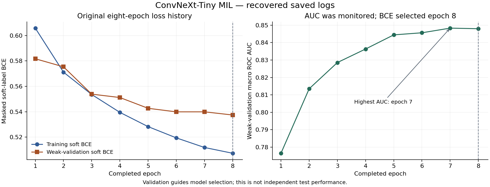

# Knee MRI Research Explorer

A project-trained **ConvNeXt-Tiny classifier** for 12 knee MRI findings, with a local CPU application for inspecting inputs and scores. The deployed model achieved **0.833 public / 0.824 private macro ROC AUC** in the [RSNA Knee Abnormality Detection competition](https://www.kaggle.com/competitions/rsna-knee-abnormality-detection).

**Research demonstration only. Not for diagnosis or patient care.** The public repository contains source, aggregate evaluation and a generated-data demo. Trained weights, scans, reports and study-level labels/predictions remain private.

https://github.com/user-attachments/assets/3e6ca849-924f-4360-852c-d34c7b04c6a2

[Watch the 60-second demo](docs/demo.mp4) · [Captions](docs/demo.vtt) · [Original training code](training/README.md) · [Model card](docs/MODEL_CARD.md) · [Local setup](docs/LOCAL_USAGE.md)

The video uses actual browser captures of generated DICOM phantoms, held for readability. These artificial inputs test software behavior; their scores have no medical meaning. The video is not a real-time latency recording.

## Problem and data

Each MRI study contains multiple series and many slices. The task predicts 12 study-level findings: ACL/MCL injury, medial/lateral meniscus abnormalities, medial/lateral/patellofemoral osteoarthritis, effusion, synovitis, Baker's cyst, contusion and fracture. Several can coexist; the model scores them without locating lesions.

Training used [Pilkwang Kim's published report-derived labels](https://www.kaggle.com/datasets/pilkwang/rsna-knee-llm-labels), rather than a project-built report extractor. `YES`/`NO` entries retain soft scores for training; `UNK` entries are masked. AUC uses explicit binary verdicts. Confidence columns are not targets or loss weights.

| Split | Studies | Role |
| --- | ---: | --- |
| Fitting | 3655 | Optimize the model with weak report-derived labels |
| Weak validation | 637 | Select checkpoints using complete masked soft-label BCE |
| Expert development | 58 | Repeatedly used development diagnostic |

Inherited group assignments were checked for separation across splits. The earlier split/cache-generation implementation is not fully reconstructed. [Label coverage](docs/ERROR_ANALYSIS.md) is uneven: only 579 fitting studies have known synovitis labels.

## Model and training

Five sequence slots cover sagittal/coronal/axial fat-suppressed and sagittal/coronal non-fat-suppressed images. Ordered DICOM slices undergo a 140 mm centre crop and 224×224 resize. Three neighbouring slices form each window; validity masks exclude missing or unusable windows.

A trainable ImageNet-initialized ConvNeXt-Tiny encodes each window. A 256-dimensional projection, slot embedding and **finding-specific gated attention** combine windows into study predictions: multiple-instance learning (MIL). Training samples two windows per slot; validation/inference use up to 40. Reports are not needed at inference.

The eight-epoch run used seed 42, batch size 2 with four-step accumulation, AdamW encoder/head learning rates of 3e-5 / 3e-4, warmup/cosine scheduling and masked soft-label BCE. Complete weak-validation BCE selected epoch 8; expert AUC and leaderboard scores were not selection inputs.



The [training archive](training/README.md) preserves original source, configuration, hashes and Kaggle versions, with training disabled in the published notebook. [Training history](docs/TRAINING_HISTORY.md) explains the curves and selection replay. Full training reproduction still requires authorized private inputs.

## Verified results

| Evidence | Recorded result | What it establishes |
| --- | --- | --- |
| Competition, deployed epoch 8 | **0.833 public / 0.824 private macro ROC AUC** | Competition ranking performance of this checkpoint |
| Weak validation, 637 studies | **0.847996 macro AUC**, soft BCE **0.537434** | Agreement with known weak labels; this split selected the checkpoint |
| Expert development, 58 studies | **0.853143 macro AUC** | A small, reused development diagnostic |
| Windows/Linux replay, 3 studies / 464 provided DICOMs | Exact processed pixels/masks; all scores within **1.20e-7** of Kaggle | Implementation consistency across deployment paths |

Both validation/development macro AUCs and all per-finding AUCs were reproduced from saved predictions and reconciled with the original run. [Evaluation](docs/PER_FINDING_EVALUATION.md) includes the evaluator, tolerances, coverage and aggregate JSON. Historical reproduction needs private inputs; artificial-data tests are public.

AUC measures ranking, not percentage accuracy or calibrated risk. Weak and expert scores use different labels/populations; the reused expert set is not an independent test cohort. Deployment replay tests implementation consistency, not accuracy.

## Lessons and unfinished experiments

- **Audit labels before blaming the encoder.** MCL and lateral meniscus have the weakest weak-validation ranking. Synovitis has only 99 known validation labels, including 13 negatives. [Error analysis](docs/ERROR_ANALYSIS.md) separates ranking from illustrative 0.5-cutoff disagreements; cases remain unadjudicated and no clinical threshold was fitted.
- **Keep checkpoint selection consistent.** An extra-epoch refinement worsened weak BCE from 0.537434 to 0.566695 and scored 0.834 public / 0.823 private. Epoch 8 remains deployed. Labels, learning rates, optimizer state and exposure changed together; this is not a label-only comparison. [Trial evidence](docs/TRAINING_HISTORY.md).
- **Record resource and readiness limits.** EfficientNet-B0 stopped at its budget gate without a validated candidate. An [attention-versus-mean pooling design](docs/POOLING_EXPERIMENT.md) remains **unrun and deferred**: complete cache shards were not located in the [scoped asset audit](docs/POOLING_FEASIBILITY.md), and CPU implementation/profiling are pending. Neither attempt supplies an architecture-improvement result.

## Run locally

**Python 3.12 is required. A public clone has no trained weights or MRI data.** Inference requires an already downloaded, authorized copy of the exact [model bundle](models/README.md). From the repository folder on Windows:

```powershell
.\setup.ps1
& '.\.venv\Scripts\python.exe' 'scripts\import_bundle.py' 'C:\path\to\authorized-output.zip'
.\start.ps1
```

Open [the local app](http://127.0.0.1:7860/) and choose **Generated software test**. Import verifies model/source identities; startup never downloads weights. Without weights, use the recorded demo, source and model-independent tests.

[Local usage](docs/LOCAL_USAGE.md) covers setup alternatives, study uploads, API, cleanup, tests and CPU Docker commands. No paid service or public inference host is configured. Setup/cold builds download free dependencies; inference runs locally.

## Application and engineering evidence

FastAPI and Gradio share a bounded queue and persistent CPU worker, with archive validation, timeouts/restart, job access tokens and temporary-file cleanup. The viewer shows sampled input crops, 12 uncalibrated scores, warnings, timing and model provenance. Job tokens are not a complete public-service authentication system.

The [three-study replay](docs/MULTI_STUDY_VERIFICATION.md) covers complete/missing slots. Linux worker processing was 3.871–10.140 seconds, with a largest cgroup peak of 1.13 GiB under two CPUs / 2 GiB. These shared-machine observations exclude upload, queue wait and model startup; they are not hosting-capacity estimates. [Container checks](docs/CONTAINER_VERIFICATION.md) cover non-root, read-only and network-disabled inference.

Further engineering details: [architecture](docs/ARCHITECTURE.md) · [tests and repeat commands](docs/LOCAL_USAGE.md#tests-and-repeat-checks) · [verification history](docs/BUILD_STATUS.md) · [final release review](docs/RELEASE_NOTES.md).

## Repository guide and limitations

| Path | Contents |
| --- | --- |
| [training/](training/README.md) | Archived original training/preparation code, configuration and provenance |
| [app/](app/) | DICOM preprocessing, model, CPU worker, API and viewer |
| [scripts/](scripts/) | Saved-prediction evaluation, analysis, bundle import and verification tools |
| [tests/](tests/) | Artificial-data evaluator tests and application/worker checks |
| [docs/](docs/) | Aggregate metrics, curves, experiment decisions and deployment evidence |

Weak-label noise, sparse supervision and sampled windows limit the model. Wider scanner/site generalization, calibration, clinical utility and real compressed-study deployment remain unverified. The metadata adapter is not validated for arbitrary clinical DICOM. See the [model card](docs/MODEL_CARD.md).

The separate **0.950 public Raptor/S6 reproduction is a different model**. Project work used AI coding assistance; methods, initialization and labels are credited in [THIRD_PARTY.md](THIRD_PARTY.md). [Portfolio wording](docs/PORTFOLIO.md) uses the same attribution.

Project-authored code/documentation are MIT licensed; dataset/model/dependency rights remain separate. Private data, weights, individual predictions and runtime files are excluded from publication.
