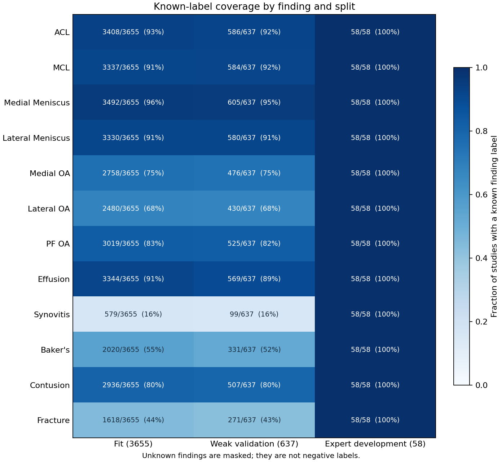
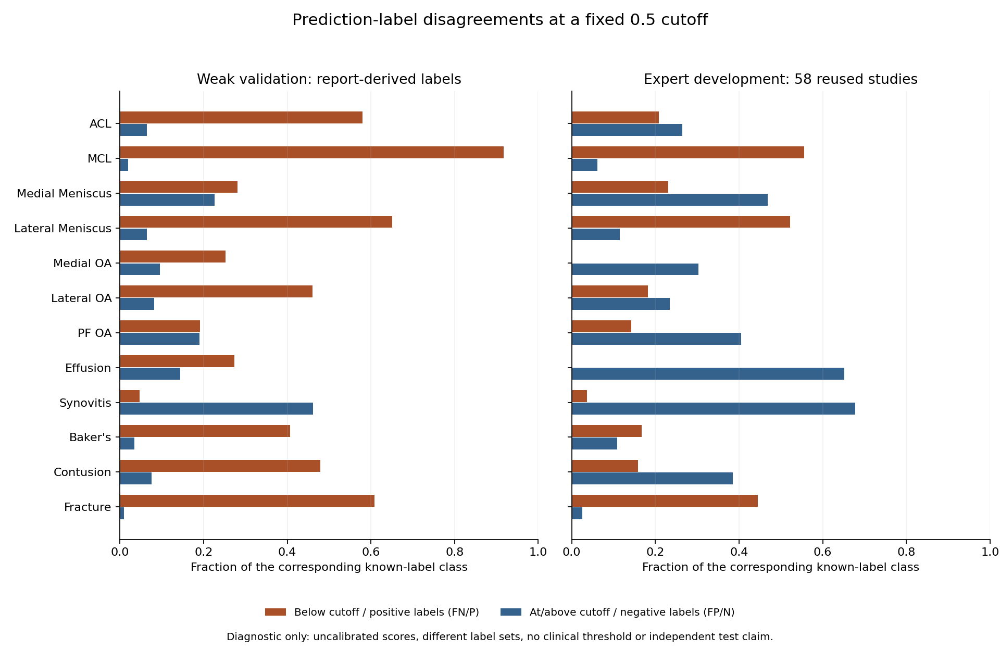

# Label coverage and prediction disagreements

This is the **29 October timeline task**, completed early on **27 October 2026** using the original epoch-8 outputs. It adds aggregate analysis and a private review queue. No model, inference session, training run, operating threshold or competition selection was changed.

The main findings are uneven supervision, weaker MCL/lateral-meniscus ranking, and large differences between ranking quality and decisions at a fixed cutoff. The data do not establish whether anatomy sampling, label noise, calibration or another factor caused any particular disagreement.

## Label coverage



There are **32321 known labels out of 43860 possible fitting study–finding entries**, **5563/7644** on weak validation, and **696/696** on expert development. These are finding-label counts, not numbers of unique patients. Every unknown remains masked; missing labels are not converted into negative examples.

| Finding | Fit known / 3655 | Fit positives / negatives | Weak known / 637 | Weak positives / negatives |
| --- | ---: | ---: | ---: | ---: |
| ACL | 3408 | 1013 / 2395 | 586 | 181 / 405 |
| MCL | 3337 | 628 / 2709 | 584 | 121 / 463 |
| Medial Meniscus | 3492 | 1941 / 1551 | 605 | 370 / 235 |
| Lateral Meniscus | 3330 | 919 / 2411 | 580 | 172 / 408 |
| Medial OA | 2758 | 1351 / 1407 | 476 | 246 / 230 |
| Lateral OA | 2480 | 897 / 1583 | 430 | 174 / 256 |
| PF OA | 3019 | 1663 / 1356 | 525 | 304 / 221 |
| Effusion | 3344 | 2235 / 1109 | 569 | 381 / 188 |
| Synovitis | 579 | 478 / 101 | 99 | 86 / 13 |
| Baker's | 2020 | 943 / 1077 | 331 | 155 / 176 |
| Contusion | 2936 | 1073 / 1863 | 507 | 188 / 319 |
| Fracture | 1618 | 249 / 1369 | 271 | 46 / 225 |

Synovitis has known labels for only about **16%** of fitting and weak-validation studies. Its weak-validation AUC rests on **86 positive and 13 negative labels**, so a small negative-class denominator matters. Fracture has about **44% fitting coverage** and **43% weak-validation coverage**, with 249 fitting positives and 46 validation positives. Baker's also has substantial missing supervision. These targets need a label-coverage audit before assuming that a larger encoder will solve their problems.

Positive fractions in the JSON are conditional on labels being known. They are not prevalence estimates for all studies: report-derived missingness may be selective. Expert development is fully labeled but has only 58 reused studies, so complete annotation does not establish independent generalization. The saved tables contain no report text or confidence columns for this analysis; no report-language, label-confidence or clinical-cause conclusion is inferred from them.

## Ranking errors

For each finding, the analysis counts all known positive–negative score pairs. A negative ranked above a positive contributes one discordant pair; a tied pair contributes one half. Their fraction equals **1 − ROC AUC**, independently of any decision cutoff. The rank counts reconcile with all original per-finding AUCs.

MCL has the largest weak-validation ranking-error fraction, **23.34%** (AUC 0.766560), followed by lateral meniscus at **21.20%** (AUC 0.787976). On the reused expert set, lateral meniscus and lateral OA have ranking-error fractions of **20.75%** and **20.50%**, respectively. These different cohorts and label sources are not a paired performance comparison, and these small development samples do not justify a significance claim.

Ranking-error fractions count score pairs, not misdiagnosed studies. Full AUCs, pair counts and ties are in the [aggregate analysis JSON](error_analysis.json). The [earlier per-finding evaluation](PER_FINDING_EVALUATION.md) documents their source and reproduction.

## Disagreements at a fixed diagnostic cutoff



The analysis fixes the cutoff at **0.5**, with scores at or above it considered positive. It does not search for a better cutoff. Here `FN/P` means the count of known positive labels with scores below 0.5 divided by all known positives; `FP/N` means known negative labels at or above 0.5 divided by all known negatives. These are disagreements with recorded labels, not confirmed clinical false negatives or false positives.

| Finding | Weak FN / positives | Weak FP / negatives | Expert FN / positives | Expert FP / negatives |
| --- | ---: | ---: | ---: | ---: |
| ACL | 105 / 181 | 26 / 405 | 5 / 24 | 9 / 34 |
| MCL | 111 / 121 | 9 / 463 | 5 / 9 | 3 / 49 |
| Medial Meniscus | 104 / 370 | 53 / 235 | 6 / 26 | 15 / 32 |
| Lateral Meniscus | 112 / 172 | 26 / 408 | 12 / 23 | 4 / 35 |
| Medial OA | 62 / 246 | 22 / 230 | 0 / 15 | 13 / 43 |
| Lateral OA | 80 / 174 | 21 / 256 | 2 / 11 | 11 / 47 |
| PF OA | 58 / 304 | 42 / 221 | 3 / 21 | 15 / 37 |
| Effusion | 104 / 381 | 27 / 188 | 0 / 35 | 15 / 23 |
| Synovitis | 4 / 86 | 6 / 13 | 1 / 27 | 21 / 31 |
| Baker's | 63 / 155 | 6 / 176 | 2 / 12 | 5 / 46 |
| Contusion | 90 / 188 | 24 / 319 | 3 / 19 | 15 / 39 |
| Fracture | 28 / 46 | 2 / 225 | 8 / 18 | 1 / 40 |

MCL's weak-label recall at this cutoff is only **10/121 = 8.26%**, despite AUC 0.766560. Conversely, effusion has expert-development AUC **0.921739**, but **15/23 = 65.22%** of expert-negative labels are above the cutoff. This demonstrates why useful ranking does not establish a useful operating point or calibrated probabilities. It does not identify a replacement cutoff.

There are **1185 weak-validation** and **174 expert-development** study–finding disagreements at 0.5. A study can disagree on several findings, so these totals are not counts of distinct studies or patients. Counts of negative labels with scores at least 0.9 and positive labels with scores at most 0.1 are also reported using fixed probes; none of the negative labels in either evaluation set has a score at least 0.9. A high model score is not calibrated confidence.

## Private review queue and limits of inspection

The local queue contains **205 finding–study entries**: up to five largest absolute score-to-binary-label disagreements in each finding/split/FP-or-FN bucket, with deterministic tie handling. It includes actual study IDs, labels and scores, so it stays under ignored `data/private_error_analysis/review_queue.csv`. No IDs, reports, scans or per-study predictions are published in the JSON, chart or this document.

This is a review queue, not a record of 205 reviewed or clinically adjudicated errors. No radiologist review or scan-based explanation was performed. The three existing MRI replay cases were selected for implementation parity, not as a representative error cohort. Their small sample cannot establish associations with missing sequences, scanner, acquisition protocol or slice selection.

For authorized private review, first verify case/label identity and available sequence metadata, then inspect the original report and full study with appropriate expertise. Keep observations separate as possible label mismatch, possible input/preprocessing issue, or unresolved model disagreement. A high-loss example alone does not prove any of those causes. Record a cause only when evidence supports it, and keep medical content private.

## Priorities supported by this analysis

1. Audit sparse synovitis/fracture/Baker's supervision and source-label handling while preserving unknown masks. Added labels need their own verification; the rejected JEV refinement shows why more supervision is not automatically better.
2. Use MCL and lateral meniscus as predeclared per-finding diagnostics in the next controlled modeling comparison. Their lower ranking AUCs are visible in the larger weak-validation cohort.
3. Keep ranking evaluation separate from operating-point work. A future threshold/calibration study needs a separate protocol and validation strategy; the reused expert58 set should not become an independent-test claim.
4. Test input-coverage or pooling hypotheses under the planned controlled experiment. These aggregate outputs contain no proof that either explains the observed disagreements, and no score improvement is promised.

## Reproduce

[The offline analysis script](../scripts/analyze_prediction_errors.py) uses the same private prediction, AUC, run-summary and checkpoint-bound label table as the [27 October evaluation](PER_FINDING_EVALUATION.md). It checks their hashes, validates all three split sizes and known-label masks, and reconciles AUCs and the original selection loss before producing diagnostics. Core reconstruction needs only Python 3.12's standard library.

```powershell
python -S scripts/analyze_prediction_errors.py --evidence-dir data/private_evaluation --output .runtime/error_analysis_rebuilt.json --review-queue data/private_error_analysis/review_queue.csv
python -m pytest -q tests/test_prediction_errors.py
```

The report should match `docs/error_analysis.json` exactly. Review-queue output is restricted to the ignored project `data/` or `.runtime/` directories. To render the two figures in a separate environment where matplotlib is installed, omit `-S` and add `--plot-dir .runtime/error_plots`. The published figures were rendered with the existing matplotlib 3.10.3 installation; serving dependencies remain unchanged.

Tests use artificial data with hand-calculated cutoff counts and tied-pair AUCs, demonstrate that perfect ranking can still give cutoff disagreements, preserve undefined denominators as null, exclude unknowns from both errors and the queue, enforce queue bounds/privacy paths, and reject modified evidence. The record is fully deterministic from the saved inputs. It adds no new training, inference, paid service or public medical-data distribution.
